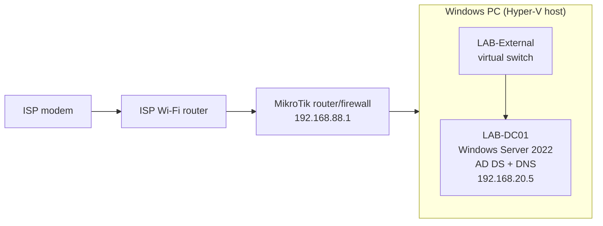

# Hyper-V Active Directory Home Lab

I built a Windows Server 2022 domain controller as a virtual machine in Hyper-V on my Windows PC and connected it to my home network. I'm using this lab to practice the skills entry-level IT roles ask for: Active Directory, DNS, user and group management, and troubleshooting.

## Status

| Component | Status |
|---|---|
| Hyper-V VM (`LAB-DC01`) | Built; running during Lab 6 check |
| Windows Server 2022 installed | Done |
| Static IP configured | Configured historically; verify current address and prefix |
| Active Directory Domain Services + DNS (`lab.local`) | Installed; prior `dcdiag` pass documented; rerun for current health |
| Organizational Units, users, and groups | Done |
| Windows 11 client (`LAB-CLIENT01`) joined to the domain | Done; running during Lab 6 check |
| Group Policy | Planned |
| Group Policy | Planned |
| Rocky Linux VM (`LAB-LINUX01`) | Installed; running during Lab 6 check |
| Lab 5 router/security audit | Preparation documented; audit findings and changes pending |\n| Lab 6 integrated verification | Selected connectivity checks recorded; topology and backup checks pending |\n| Network isolation (private switch or VLAN) | Planned |

| Home network security audit | Done |

## Architecture

The `LAB-External` virtual switch uses the host PC's network adapter. Lab 6 records the domain controller and Linux VM on `192.168.20.0/24`, while the Windows client is recorded on `192.168.88.0/24`. See [Lab 6 integrated verification](docs/06-lab6-integrated-verification.md) for recorded addresses, connectivity tests, and outstanding topology checks. Do not assume these are one flat subnet.

| Client setting | Value |
|---|---|
| Client VM name | `LAB-CLIENT01` |
| Client guest OS | Windows 11 Enterprise (Evaluation) |
## Environment

| Item | Value |
|---|---|
| Host OS | FILL IN (for example, Windows 11 Pro) |
| Hypervisor | Hyper-V |
| Host CPU / RAM | FILL IN |
| VM name | `LAB-DC01` |
| VM generation / memory / vCPUs | FILL IN (check the VM's Settings in Hyper-V Manager) |
| Virtual disk | 80 GB, dynamically expanding VHDX |
| Guest OS | Windows Server 2022 Standard Evaluation (Desktop Experience) |
| Domain | `lab.local` (NetBIOS name `LAB`) |
| DC IP address (Lab 6 record) | `192.168.20.5` (verify live) |
| Lab 6 gateway recorded for Linux/DC network | `192.168.20.1` (confirm interface and route mapping) |
| DNS server on the DC | `192.168.20.5` (itself; verify live configuration) |
| Virtual switch | `LAB-External` (external) |

## Documentation

- [Build steps](docs/01-build-steps.md): how I built the lab from an empty Hyper-V host to a healthy domain controller
- [Lab 2: Windows client VM](docs/03-lab2-client-vm.md): building `LAB-CLIENT01` and joining it to `lab.local`
- [Troubleshooting log](docs/02-troubleshooting.md): problems I hit, what caused them, and how I fixed them
- [`scripts/verify-dc.ps1`](scripts/verify-dc.ps1): a PowerShell script that runs the health checks I used to verify the DC
- [Lab 4: Rocky Linux VM](docs/05-lab4-linux-vm.md): building `LAB-LINUX01` and verifying networking
- [Lab 6: Integrated verification and closeout](docs/06-lab6-integrated-verification.md): current three-VM inventory, recorded network tests, and remaining closeout checks
 

## 10. Locked out of the MikroTik admin login

**Symptom:** After changing the router's admin password from the factory default, logins through the web interface and through WinBox (Neighbors, by MAC address) were rejected, including with the passwords I had written down. The router log showed the failed logins coming from my own PC (192.168.88.253), not from an outside source.

**Cause:** The new password wasn't stored anywhere reliable, and none of the variants I tried matched.

**Fix:** Performed a hardware reset (hold the Reset button while powering on, release at the first LED flash). The router had only a few changes beyond defaults, so little was lost. Logged in with the default password from the device sticker, set a new admin password immediately, set the Wi-Fi name and password, renamed the router identity to `LAB-RTR01`, and took a configuration backup. Credentials are stored in a password manager.

**Lesson:** Save a credential in a password manager the moment you set it, and keep a configuration backup so a reset is cheap. Reading the router's log was also a useful way to confirm the failed logins were mine.

## Skills practiced

- Creating and managing virtual machines in Hyper-V (virtual switches, virtual disks, ISO attachment, boot order, checkpoints)
- Installing and configuring Windows Server 2022
- Configuring a static IP address and planning around an existing DHCP range
- Installing AD DS and promoting a domain controller for a new forest
- Configuring DNS for Active Directory
- Diagnosing problems with `dcdiag`, `nslookup`, `nltest`, and `w32tm`

## Lessons learned

- A domain controller needs a static IP and should use itself for DNS.
- Active Directory depends heavily on DNS and correct time. Many `dcdiag` failures come from one of those two.
- Take a checkpoint after every major milestone so you can roll back.

## Notes

- The Windows Server evaluation license lasts 180 days.
- I did not install the Windows DHCP role, because my MikroTik router already hands out addresses on this network.
- No passwords, license keys, or public IP addresses are stored in this repo.
